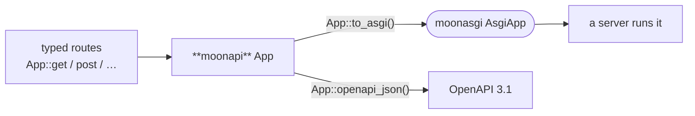

<div align="center">

# moonapi

**A typed web framework for MoonBit.**

[](./LICENSE)
[](https://mooncakes.io/docs/moonbitstack/moonapi)

</div>

`moonapi` builds a server application from typed routes and generates its own
OpenAPI document. One application object holds the routes, the layers around
them, the exception and per-status handlers, the security schemes, the lifespan
hooks and the OpenAPI metadata; the same object compiles to a server that runs
natively or in WebAssembly.



## Quickstart

Routing and the OpenAPI document build on every backend. Handlers are async, and
serving needs a socket, so the entry point is `async fn main` and the target is
native or wasm:

```moonbit
async fn main {
  let app = @moonapi.App::new()
  app.get("/", _ctx => @moonapi.text(200, "Hello from moonapi!"))
  app.get("/users/{id}", ctx => @moonapi.text(
    200,
    "user " + ctx.param("id").unwrap_or(""),
  ), summary="fetch a user")
  app.post("/users", _ctx => @moonapi.text(201, "created"))

  // One set of routes, every mainstream spec version.
  println(app.openapi_json(version=OpenApi31)) // OpenAPI 3.1.0
  println(app.openapi_json(version=OpenApi30)) // OpenAPI 3.0.3
  println(app.openapi_json(version=Swagger20)) // Swagger 2.0

  @mooncat.serve(app.to_asgi(), port=12000) catch {
    err => println("stopped: \{err}")
  }
}
```

```
moon run src/main --target native
curl http://127.0.0.1:12000/users/233
```

`moon.mod` needs `moonbitstack/moonapi`, and — for the serving half —
`moonbitstack/mooncat` plus `moonbitlang/async`, which `async fn main`
requires by name. The package importing them needs the same three in its
`moon.pkg`. Drop the server and the app still runs in-process on native, wasm and
js: `App::handle` drives it through the same path a server does.

`App::enable_docs()` mounts `/openapi.json`, `/docs` and `/redoc` instead of
printing the document; `scalar_ui()`, `swagger_ui()` and `redoc_ui()` return
those pages on their own.

For a runnable integration of the root API, two routers, authentication,
validation, middleware, background work, streaming and docs, see the
[complete application example](src/examples/25-full-example/). The full example list
is in [src/examples/README.md](src/examples/README.md). On Windows, macOS or Linux, start
the native server with `moon run src/examples/25-full-example --target native`. The service
provides the API reference at `http://127.0.0.1:12000/docs`, ReDoc at
`http://127.0.0.1:12000/redoc`, and OpenAPI 3.0.3 at
`http://127.0.0.1:12000/openapi.json`.

## Examples

The [`src/examples`](src/examples/) directory is a runnable tour of the public API. Each
numbered example has a runnable `main` package that isolates one feature:

| Example | Shows |
|:--:|:--|
| `01-openapi` | building an OpenAPI document |
| `02-routing` | verbs, path parameters, and the 404-vs-405 distinction |
| `03-openapi-versions` | the same routes emitted as Swagger 2.0, OpenAPI 3.0 and 3.1 |
| `04-descriptors` | the descriptor tree behind a typed route |
| `05-constraints` | field constraints, documented and enforced |
| `06-typed-body` | validated and unchecked JSON body extraction |
| `07-request-extractors` | query, headers and body from the context |
| `08-response-model` | filtering a handler's return to a declared model |
| `09-dependency-injection` | the container, scopes and teardown |
| `10-oauth2-jwt` | an OAuth2 password grant and bearer enforcement |
| `11-per-op-security` | security requirements on individual routes |
| `12-security-schemes` | the six OpenAPI scheme shapes |
| `13-forms-files` | form and file uploads with size bounds |
| `14-background-tasks` | work deferred until after the response |
| `15-mounting` | composing sub-applications under a prefix |
| `16-middleware` | layers and middleware around the router |
| `17-sse` | server-sent events |
| `18-websocket` | a live WebSocket connection |
| `19-json-schema` | JSON schema generation |
| `22-docs-ui` | the documentation pages |
| `23-lifespan` | startup and shutdown hooks |
| `24-files` | serving files with range and conditional handling |
| `25-full-example` | everything composed into one service |
| `26-described-model` | describing a model once, using it four ways |
| `27-annotations` | registering routes from annotated functions |
| `28-templates` | rendering HTML templates |

Run any of them with, for example:

```
moon run src/examples/02-routing --target native
```

## Packages

Each concern is its own subpackage, so a program links the parts it uses. The
root re-exports all of them, so `@moonapi.App`, `@moonapi.text` and the rest work
as they always did. `templates` and `static` are the exception: they bring
dependencies of their own, so a program imports them by name.

|  Package  | What it holds | Depends on |
|:--:|:--|:--|
| `moonapi` | `App` and its methods, the façade | everything below |
| `moonapi/templates` | `Templates`: pages rendered into responses, with `request` and `url_for`; `load_directory` (native) | moonpug, `ctx` |
| `moonapi/static` | `serve`, a `Source` trait, `Memory` and `Directory` (native) | `ctx` |
| `moonapi/route` | `Route`, `WsRoute`, `Router`, path templates; `Method` from moonhttp | `ctx`, `endpoint`, `security`, `socket` |
| `moonapi/cmd/routes` | the annotation generator, run as a build rule | moonast |
| `moonapi/openapi` | the document's info block, routes as operations | `route`, `schema` |
| `moonapi/security` | schemes, guards, per-operation requirements, tokens | `ctx`, `schema`, `status` |
| `moonapi/exceptions` | `HttpException` and exception handlers | `ctx` |
| `moonapi/endpoint` | `Param`, `ResponseSpec`, `Endpoint` and its validation | `ctx`, `schema` |
| `moonapi/ctx` | `Context` and every extractor, background tasks | `schema`, `status` |
| `moonapi/schema` | `Schema`, constraints, `ValidationError`, `of_model` | `status` |
| `moonapi/socket` | the live WebSocket connection | nothing |
| `moonapi/status` | response helpers, streams, SSE, cookies, status constants | nothing |
| `moonapi/di` | dependency injection | nothing |

**Constructors are written without the package.** `pub using` re-exports types
but not their constructors, so `@moonapi.OpenApi31` does not resolve. Wherever
the expected type is known — an argument, a field, a match — the bare name does:
`version=OpenApi31`, `Param::new("id", InPath, schema=SInt)`. The one place it
is not known is a raised error, where the subpackage is named:
`raise @exceptions.HttpException(...)`.

## Features

- **Routing** — `App::get/post/put/patch/delete/route` on path templates: `{name}` binds one segment or part of one, `{id:int}`, `{x:float}` and `{id:uuid}` bind only what fits, `{rest:path}` binds the rest slashes included, and the result lands in `Context::param`. The convertor also types the parameter in the OpenAPI document. Correct `404` (no path) versus `405` (path but not method), and a path off by a trailing slash answers `307` to the one that exists. A route takes the operation arguments — `summary`, `description`, `tags`, `deprecated`, `operation_id`, `status_code`, `responses`, `name`, `include_in_schema`, and an `openapi_extra` fragment merged over the generated operation object — and `App::url_for(name, params)` resolves a named route back to its path, mount prefix included.
- **Routers** — `Router` collects routes away from any application, and `App::include_router(router, prefix=, tags=, security=, dependencies=, responses=, deprecated=, include_in_schema=)` folds them in as the app's own. The arguments given at the join reach every route in the group: tags, security requirements and dependencies lead the route's own, group responses are documented under it, and `deprecated` / `include_in_schema` mark or hide the whole set. A router is a value, so the same one can be included twice under different prefixes. Routers include routers, so a large API is a tree included once.
- **Middleware** — middleware on a route or a router node (`hoops=`, `Router::hoop`): it runs inside the app's middleware and outside the route's security, validation and dependencies, so it can answer for the route, change its reply, or hand the rest a context of its own. The hoops of include calls and routers wrap the route's own, outermost first.
- **Views and route tables** — a type implementing `View` answers the methods of one path, and a request for any other gets a `405` whose `Allow` lists what it does answer. `app.urls([path(...), view(...), websocket(...), group("/blog", [...])])` registers a route table kept apart from the handlers, with groups nesting and carrying tags, security, dependencies and hoops.
- **Descriptor tree** — a runtime `Schema` / `Param` / `Endpoint` tree that a typed route carries. Walked **once** to (a) emit **complete** OpenAPI request/response body schemas — objects, arrays, scalars, `required`, nullable (`type: [t, "null"]` in 3.1, `nullable` in 3.0, `x-nullable` in 2.0), a `Map[String, T]` as `additionalProperties`, `Any` as the empty schema, a `format` such as `binary`, and defaults, with named models hoisted under `components/schemas` and referenced by `$ref` — and (b) drive request validation off the same tree. A `Param` carries the same constraints a `Field` does, plus a `default` and an `alias`, so a query parameter's bounds are both documented and enforced, and a `422` points at the name the client actually sent. User structs describe themselves with `derive(ToJson)` + a `T::schema()` associated function + a one-line `ToSchema` bridge.
- **Multi-version OpenAPI** — `App::openapi_json` emits **Swagger 2.0, OpenAPI 3.0.3, and OpenAPI 3.1.0** from the same routes and descriptors (3.x `requestBody` + `components/schemas`; 2.0 body-parameter + `definitions`). `App::describe` adds the summary, tag descriptions and external documentation; `app.webhooks` documents the requests the API sends out (3.1 `webhooks`); a route's `callbacks` documents the requests an operation makes back to its caller; and a `Param`, a request body, a `ResponseSpec` and a `Field` each take named `examples`.
- **Typed body extractors** — `Context::body[T]` deserialises the JSON body into a `derive(FromJson)` struct; `Context::body_validated[T]` first checks it against the endpoint descriptor and returns either the built value or a located `422` error list — schema emission, validation, and deserialisation all off one descriptor.
- **Dependency injection** — a `Container` (provider registry) with request-scoped, one-shot resolution (per-request caching) and `yield`-style teardown run LIFO around the handler. `App::depends(container.erase())` attaches one to the application, and any route builder takes `dependencies=["key"]`: the keys resolve before the handler and are torn down after it, whatever the handler did. The teardown is handed the error that ended the request, so cleanup can tell a rollback from a commit.
- **OAuth2 + JWT security** — a `/token` password-grant endpoint issues an HS256 JWT (`create_access_token`), and an `OAuth2PasswordBearer` reads the `Authorization: Bearer` header, verifies the token, and enforces scopes: `401` on a missing or invalid/expired token, `403` when a valid token lacks a required scope. The token itself is `mooncred`'s and the algorithms are `mooncrypt`'s; moonapi names HS256 and hands over a key. `alg: "none"` cannot be expressed, the verifier's algorithm is the one that counts rather than the token's, and signatures compare in constant time.
- **Form & file extractors** — `Context::form` parses both an `application/x-www-form-urlencoded` body (percent- and `+`-decoded) and a `multipart/form-data` body, splitting the boundary stream into fields and byte-exact uploads (filename + content-type + `size` + the part's own headers + raw bytes). Reading the body is `moonhttp/form`'s, over moonmime and moonurl; a body is attacker-controlled and already buffered, so `@moonmime.Limits` bounds what one may spend — a thousand parts of a megabyte by default — and a body over either bound comes back as `None`, refused whole rather than truncated. `Context::oauth2_password_form` reads the OAuth2 password form off it.
- **response_model** — `filter_response` / `json_model` validate a handler's return value against a declared `Schema` and project it down to exactly the model's fields, so a route can hold a richer object internally than it exposes (an id, a password hash) and still emit only what it promised.
- **Middleware & exception handlers** — two kinds of middleware. `App::layer` takes any moonasgi `@mid.Layer`, which wraps the ASGI application and sees every event, so streams stay streams and WebSocket traffic passes through: moonasgi ships `Cors`, `Gzip`, `TrustedHosts`, `HttpsRedirect` and `ServerErrors`, and `Wrap` turns any function from app to app into one. `App::middleware` is a function of the request and `call_next` that returns the response, whole. Layers and middleware wrap the app in one list, in registration order with the first outermost, and they wrap mounted applications too. Exception handlers (`App::exception_handler`): a handler `raise`s an `HttpException` and the app maps it to a response, falling through to a built-in `{"detail": ...}` for `HttpException` and a `500` for anything else. `App::add_status_handler(code, ...)` swaps in a custom response for any error status — a routing `404` / `405` or a raised exception's status — so an app can serve its own error pages.
- **Per-operation security** — a route carries `security=[SecurityRequirement::new(scheme, scopes=[...])]`, and every scheme shape has a guard: `secure_oauth2`, `secure_oauth2_code`, `secure_bearer`, `secure_api_key` (header / query / cookie), `secure_basic`, `secure_digest`, `secure_openid`. Each surfaces the scheme in the spec *and* registers the check that runs **before** the handler — `401` with the `WWW-Authenticate` challenge the scheme owes (a scoped bearer route names the scope it wanted), `403` on a missing scope or a rejected API key. Every one takes `description=` and `auto_error=` (with the flag off, the guard admits an anonymous caller and leaves the decision to the route). A bare `add_security_scheme` documents without enforcing.
- **Background tasks** — every handler has `ctx.background`; `add_task` defers async work that the app runs, in order, **after** the last body event is sent, so a slow write never delays the client.
- **Sub-application mounting** — `App::mount(prefix, subapp)` composes applications: a request under `prefix` reaches the sub-app with the prefix moved from `path` to `root_path` (its own layers, security and background tasks apply), and the sub-app's routes and security schemes fold into the parent's merged OpenAPI document under the prefix. Mounts nest, and a sub-app's lifespan hooks run with the parent's. `App::mount_asgi(prefix, app)` mounts any other ASGI application the same way — a third-party component, or static files — which the app routes to but does not document.
- **Streaming responses** — `App::stream(path, handler)` / `App::route_stream(verb, ...)` register a route returning a `Stream`, whose body writes through a `Writer`: each `write` is one body event, so a client reads the first long before the last one exists, and HTTP trailers follow the body when the route declares them. A client that leaves cancels the body. Layers see each event as it goes; an `App::middleware` gets the response whole, so the stream is gathered for it.
- **Server-Sent Events** — `moonhttp/sse` frames an event per the WHATWG event-stream format (`id` / `event` / `retry` / multi-line `data` / `:` comments); `sse(body)` is a `text/event-stream` `Stream` whose body sends those frames through `Events::send` and `ping`, **one body event per frame**, so each dispatches on arrival. A client that reconnects sends the last id it saw, and `ctx.last_event_id()` lets the stream pick up after it.
- **WebSocket routes** — `App::websocket(path, handler)` over the moonasgi WebSocket protocol. The async handler holds the live connection: `accept` (with a subprotocol and headers), `receive` / `receive_text` / `receive_bytes` / `receive_json`, the matching `send_*`, and `close`. It can speak first and answer as messages arrive; a client that leaves raises `Disconnected(code~, reason~)` out of `receive`, which ends the handler quietly unless it catches it. A route takes `security`, `dependencies` and a `name` like an HTTP route; a refused connection is declined at the handshake with the HTTP answer where the server allows it, or close code 1008. The moonasgi test client's `websocket` drives a route in-process.
- **Security schemes** — the six OpenAPI shapes (OAuth2 password and authorization-code flows, HTTP bearer / basic / digest, an API key in a header / query / cookie, and OpenID Connect) are emitted in each dialect's form: `components/securitySchemes` in 3.x, `securityDefinitions` in 2.0, where an `http` scheme becomes the standard `apiKey`-in-`Authorization` workaround and OpenID Connect — which 2.0 cannot express — is left out rather than described as something it is not.
- **Documentation UI** — `App::enable_docs()` mounts `/openapi.json`, `/docs` and `/redoc`, all three with `include_in_schema=false` so turning documentation on does not change the document. `/docs` is the Scalar reference by default and Swagger UI with `ui=Swagger` (with its OAuth2 redirect page and `init_oauth`); every reader is loaded at a pinned version, and behind a proxy the pages and the document's servers follow the ASGI `root_path`. `scalar_ui()`, `swagger_ui()` and `redoc_ui()` return the pages alone, for an app that serves them under its own paths or behind its own guard.
- **Templates** — `moonapi/templates` renders moonpug templates into responses: every page sees `request`, `url_for` resolves named routes, context processors add names to every page, and where the call's `context` and a processor name the same thing the rule is published (`wins`, `clash`). `load_directory` reads a template tree once on native.
- **Static files** — `moonapi/static` serves a `Source` under a mount with the same conditional and range handling as `Context::serve`, a `405` for anything but `GET` and `HEAD`, no way out of the source, and an `html` mode with indexes, the trailing-slash redirect and a `404.html`. `Memory` works on every target, `Directory` reads the disk on native, and a source of your own is one trait implementation.
- **Lifespan hooks** — `App::on_startup` / `App::on_shutdown`, driven over the ASGI lifespan protocol. Startup in registration order, shutdown in reverse, so a resource is released before whatever opened it. A hook gets the lifespan state, and what it stores there reaches every request as `ctx.state()`. The moonasgi test client's `lifespan` runs the same thing in-process.
- **Responses** — `text`, `html`, `json` and `json_model` helpers over `moonasgi.Response`, plus `redirect(url, status=307)` (the URL is encoded over the characters a URI reserves for structure, so an already-encoded URL passes through and a smuggled `CRLF` cannot open a header) and `file_response(content, filename=, media_type=, inline=)` (a media type guessed from the extension, `Content-Length`, and a `Content-Disposition` that falls back to RFC 6266's `filename*` when the name will not survive quoting). It takes bytes rather than a path because moonapi has no filesystem — the same app runs on wasm, js and native.
- **Conditional and partial serving** — `Context::serve(content, ...)` is `file_response` with the request weighed: `304` when the client's copy is current, `412` when a precondition fails, `206` for a range (one `Content-Range`, or `multipart/byteranges` for several), `416` for a range that is not there. This is what makes a download resumable. The entity-tags, the five precondition fields and the range arithmetic are [moonhttp](https://github.com/moonbitstack/moonhttp)'s `conditional` and `range`, so it is RFC 9110 §13 and §14 rather than a guess. Everything turns on `etag=`; left out, one is hashed from the content, which costs a pass over the body — pass `@conditional.stamp(length~, modified~)` for one stat's worth instead.
- **Data URLs** — `data_response(url)` serves what a `data:` URL carries, under the media type it names; `data_url(content, media_type=)` writes one. This is what `canvas.toDataURL()` and `FileReader.readAsDataURL()` hand back, and how a client posts an image inside a JSON field. Not a data URL yields `None`, so a handler tells "no picture" from "not a picture" without touching base64.
- **Cookies** — `set_cookie(resp, name, value, max_age=, expires=, path=, domain=, secure=, http_only=, same_site=)` and `delete_cookie(...)`. Each returns a new response carrying one more `Set-Cookie`, which is the correct wire shape: two cookies are two headers, never one folded field. `expires` is a `@moondate.Moment`, because an expiry is a moment and the format says how to write one; `delete_cookie` expires by both `Max-Age=0` and the epoch. `Context::cookie` reads them back. The cookie itself — both headers, each read and written, and the stripping of the octets RFC 6265 forbids so a value cannot forge an attribute or open a header of its own — is [moonhttp](https://github.com/moonbitstack/moonhttp)'s `cookie` package, which a client uses from the other side.
- **Status constants** — the `HTTP_*` and `WS_*` names, so a route table shows a deliberate `307` rather than a bare number.
- **One description, several uses** — `Schema::of_model(model, known=)` takes a [moonmodel](https://github.com/moonbitstack/moonmodel) description and gives back a schema, so the same declaration that produces the SQL columns in moonorm and the SDL in moongql drives validation and the OpenAPI document here. Written once, read four ways. A `Ref` is looked up in `known`; one that is missing, or that leads back into a model already being written, comes back in the second return value with the reason rather than being guessed at — a schema is a finite value, so a cycle cannot be one. Nothing else changes: the hand-written `Schema` tree is still there and still the shorter way to say something small.

## Configuration

Nothing here decides for you twice. Every bound is an argument with a published
default, and every default is a sensible one.

```moonbit
ctx.query("tag")                                       // the preset bound
ctx.query("tag", limits=@moonurl.Limits::new(pairs=100000))
ctx.form(limits=@moonmime.Limits::new(part_size=8 << 20))  // an upload endpoint

@moonapi.create_access_token(sub, secret, now, extra={ "tenant": Json::string("acme") })
@moonapi.sse(body, headers=[("cache-control", "no-store")])
@moonapi.sse(body, space=false)
```

| Setting | Default | Why that one |
|:--:|:--:|:--|
| `query_limits.pairs` | 1000 | a thousand query parameters is a generous ceiling |
| `query_limits.size` | 64 KiB | past the 8 KiB the common servers allow a whole request line |
| `form`'s `limits` | `@moonmime.limits` | a sane file and field count, with a part size bound |
| `expires_in_secs` | 3600 | the hour a token grant issues |
| `space` on a stream | on | the space after a colon is universal on the wire and stripped by every reader |
| `redirect_slashes` | on | a link written with or without its trailing slash still arrives |

### Where a setting can arrive twice

`create_access_token` computes `sub`, `iat`, `exp` and `scopes` from its
arguments, and `extra` adds claims alongside them. `sse` sets the three
headers a stream needs, and `headers` adds its own. Where the two name the same
thing, the rule is published rather than implied:

| Function | Who wins by default | What happens when both speak |
|:--:|:--:|:--|
| `create_access_token` | the arguments | aborts — a token whose subject is not the `subject` passed in is a mistake in the program |
| `sse` | the caller's header | replaces ours, so a response never carries two `content-type` headers |

Both take `wins` to turn the direction around and `clash` to choose between
merging in silence, aborting, and handing the decision to a callback of your
own. They are the same `wins` and `clash` `mooncred` uses, with the same
meanings.

## Design notes

- **One path for every caller.** `App::to_asgi` is the application; `App::handle`, the test client and a server all go through it, so a test exercises the layers, mounts, lifespan state and disconnect handling a server does, not a shortcut beside them.
- **Middleware that is not moonapi's lives in moonasgi.** CORS, gzip and the host checks are ASGI layers, so a moonapi app, a moongql endpoint and a hand-written ASGI app share one implementation and one configuration.

## Roadmap

The descriptor tree (`Endpoint` / `Param` / `Schema`) drives OpenAPI body schemas and validation; on top sit the typed `derive(FromJson)` body extractors, the dependency-injection container, the OAuth2 password-bearer security layer, the `Form` / `File` extractors, and `response_model` filtering. Around them: ASGI layers, exception and per-status handlers, streams, Server-Sent Events, and live WebSocket routes.

**0.9.0 is where moonapi stopped being several libraries at once.** The cryptography went to `mooncrypt`, the token format to `mooncred`, the wire formats to `moonhttp`, the compression to `moonzip`, and the JSON to `moonjson` — out of the framework and into libraries anything can use, with every existing test still passing. What is left is routing, extraction, validation, OpenAPI, injection and middleware, which is what a web framework is.

**0.13.1 finished the file story.** `Context::serve` weighs the conditional fields and the `Range` before answering, so a download resumes and a repeat request costs a header rather than a body. The tags, the fields and the arithmetic are `moonhttp`'s; the four answers and the envelope are here.

**0.17.1 made moonapi ASGI-native.** Handlers are async and a request runs as ASGI events end to end: streams write as they go, a WebSocket handler holds the live connection, background tasks run after the last body event, and CORS and gzip are moonasgi layers. Moving from 0.17.0: `cors(...)` and `gzip(...)` become `app.layer(@mid.Cors::new(...))` and `app.layer(@mid.Gzip::new(...))`; `route_bg` becomes a plain route using `ctx.background`; `sse_response(events)` becomes `sse(e => ...)`; lifespan hooks take the state map; `mount_handler` is `mount_asgi`; `moonapi/mid` is `moonapi/exceptions`. (This section is a changelog for existing users; new projects start at 0.17.2.)

**0.17.2 settled the routing surface.** Paths are templates with convertors (`{id:int}`, `{rest:path}`), a path off by a trailing slash is redirected, WebSocket routes take security, dependencies and a name, routers nest and carry hoops, and a type or a route table can stand in for one call per route. Templates and static files are subpackages of their own; the document gains webhooks, callbacks, examples and tag metadata; `/docs` serves the Scalar reference, with every reader pinned. Moving from 0.17.1: write `{id}` where `:id` was; a router's `/` under a prefix is `/prefix/`; `@socket.WsRoute` is `@route.WsRoute`; build `License`, `Contact` and `Server` with their `new`, and `Param`, `ResponseSpec`, `Endpoint` and `Field` with theirs, since each gained a field; pass `ui=Swagger` to keep Swagger UI at `/docs`, and `App::new(redirect_slashes=false)` to keep the old `404`.

Next: splitting what remains into packages, so a program that wants the router does not link the OpenAPI writer; `regex=` and `glob=` routes; and codegen'd request schemas.

## Documentation site

The `docs/` directory holds the published site — a homepage, a progressive
[guide](docs/guide.html), the full [API reference](docs/api.html) generated from the
package interfaces and source comments, and an interactive
[showcase](docs/index.html). Open `docs/index.html` after building, or serve the
directory with any static server.

## License

Apache-2.0.
